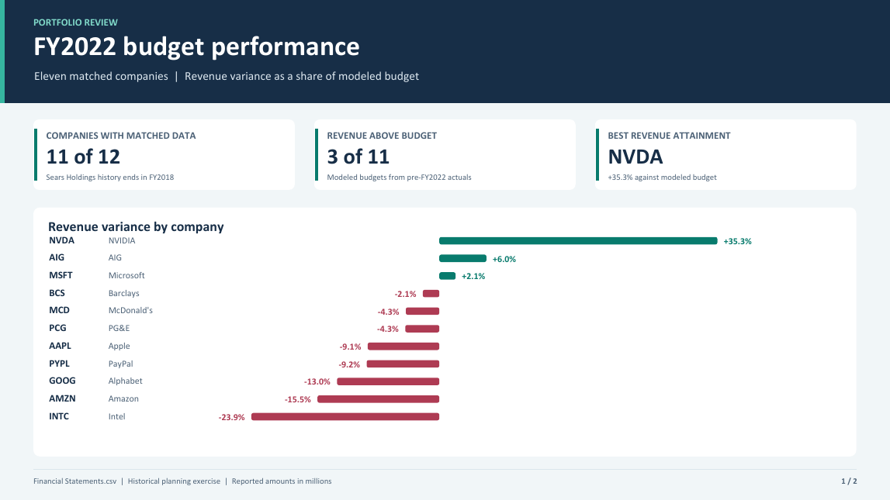

# Budgeting & Forecasting in Excel and Power BI

I built this as a self-directed FP&A portfolio project to test budgeting and forecasting models using **real historical financial statement data** from 12 publicly traded companies. I created the budgets and forecasts as illustrative estimates for the project.

## Project files

| File | What it contains |
| --- | --- |
| [Excel model](Budget-and-Forecast.xlsx) | Company models, budget vs. actuals, editable forecast cases, variance bridges and audit checks |
| [Power BI project in the full project ZIP](Budgeting-Forecasting-GitHub.zip) | Interactive portfolio comparison and company-level revenue, profit and cash flow views |
| [Portfolio review](Portfolio-Review.pdf) | Two-page FY2022 executive summary with an Apple net income variance bridge |
| [Company briefs](Company-Budget-Briefs.pdf) | One presentation page for each of the 12 companies |

## Data and assumptions

- Actuals come from *Financial Statements of Major Companies (2009–2023)*, a public compilation of reported company financial figures. The project uses revenue, gross profit, net income and operating cash flow from 161 company-year records. Selected values were checked against primary filings. [Kaggle dataset by rish59](https://www.kaggle.com/datasets/rish59/financial-statements-of-major-companies2009-2023) · [Apple FY2022 10-K](https://www.sec.gov/Archives/edgar/data/320193/000032019322000108/aapl-20220924.htm) · [Amazon FY2022 10-K](https://www.sec.gov/Archives/edgar/data/1018724/000101872423000004/amzn-20221231.htm)
- Each historical budget uses the preceding three consecutive actual fiscal years. The model applies a two-year revenue CAGR and median operating ratios. The net income bridge reconciles the revenue, cost of revenue and other net expense impacts.
- FY2023–2025 scenarios use a **FY2022 planning cutoff**. Microsoft and NVIDIA supply the FY2023 holdout actuals. Sears Holdings ends in FY2018.
- Amounts preserve the source reporting basis in millions. Portfolio attainment compares company-level percentages. Sector views use the median among records with both actual and budget.

## Open and refresh

1. Download and extract the [full project ZIP](Budgeting-Forecasting-GitHub.zip). Open the workbook in Excel and start on **Overview**. Change the forecast case or the blue assumptions on **Assumptions**.
2. Keep the two Power BI project folders next to the PBIP file. Open the project in **Power BI Desktop** and choose **Refresh** to load the included demonstration snapshot on the first open.
3. To connect Power BI to your edited workbook, save the workbook, then open **Transform data → Manage parameters** in Power BI and set **WorkbookPath** to the workbook's full local path. Apply the change and refresh. An empty parameter loads the included snapshot.

## FY2022 example

Three of the 11 comparable companies exceeded their modeled revenue budgets. Apple's revenue was 90.9% of its modeled budget, while its net income exceeded that budget by 5,875 million on the source reporting basis.
